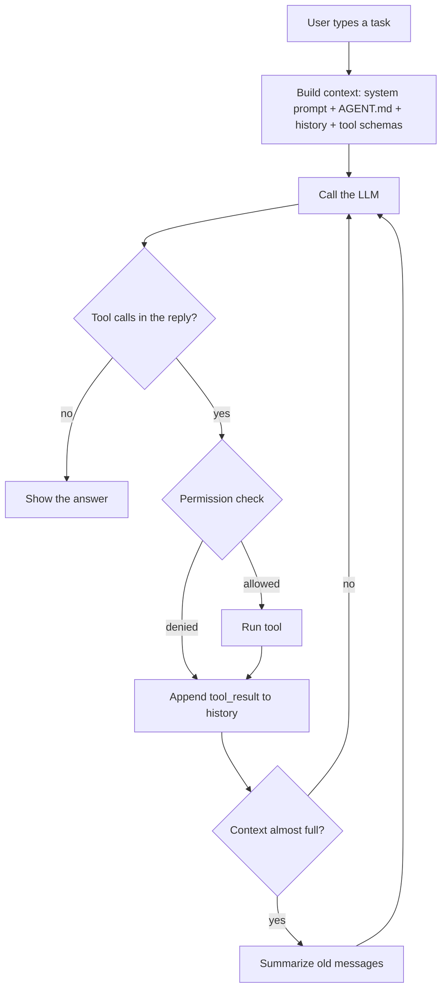

# mini-claude

A small AI coding agent for the terminal, built from scratch to learn how harnesses
like Claude Code work behind the scenes. The code is under 2,000 lines of TypeScript,
with no AI SDKs and only one runtime dependency (`tsx`).

```
> The README has leftover git merge conflict markers. Fix them.
  > Reading README.md
  > Editing README.md
Allow edit_file README.md ...? [y = yes, n = no, a = always allow edit_file, ...] y
Removed the conflict markers and kept the project title at the top.
[turns=3 | total tokens in=9120 out=310]
```

## The one idea

**The model only produces text. The harness is everything else.** It is the code
that sends the conversation, turns `tool_use` requests into real actions, feeds the
results back, asks your permission, and keeps the context small.



## Quick start

```bash
cd ai-harness
npm install
cp .env.example .env
```

Choose a model in `.env`:

- **Claude**: set `ANTHROPIC_API_KEY` (the best results).
- **Free and local**: install [Ollama](https://ollama.com), run `ollama pull qwen2.5:7b`, and set
  `MINI_CLAUDE_PROVIDER=ollama` and `OLLAMA_MODEL=qwen2.5:7b`.

```bash
npm start                                    # chat in the current directory
npm start -- --cwd ../ "explain routes/web.php"   # one-shot, in another project
npm start -- --resume                        # continue the last session
npm test                                     # 60 tests, fake LLM, no API key needed
npm run eval -- --runs 3                     # real tasks against a real model, pass rate
npm link && mini-claude                      # install as a command
```

### Options and commands

| Flag | Meaning |
|------|---------|
| `--cwd <dir>` | Project to work in (default: current directory) |
| `--mode ask\|auto\|read-only`, `-y` | Permission mode (`-y` = auto) |
| `--resume`, `--session <id>` | Continue a saved session |
| `--max-turns <n>` | Max model calls per request (default 25) |
| `--no-stream`, `--no-subagents` | Turn off streaming or the `task` tool |

In the REPL you can use `/help`, `/history`, `/system`, `/context`, `/compact`, `/memory`,
`/sessions` and `/mode`. A line starting with `# text` is saved to `./AGENT.md`.
Ctrl+C interrupts the agent, and pressing it twice quits.

## Learn it in 10 lessons

Each lesson has a note in [`notes/`](notes/) with the concept, the code to read, what
happened with a real model, and exercises. Each lesson is also a separate commit, so
`git log` shows the harness growing step by step.

| # | Lesson | Main files |
|---|--------|------------|
| 1 | [Raw LLM call](notes/01-raw-llm-call.md): messages, roles, statelessness | `examples/01-raw-call.ts` |
| 2 | [Chat history](notes/02-chat-history.md): memory is just resending | `src/index.ts` |
| 3 | [Provider abstraction](notes/03-provider-abstraction.md): Anthropic, Ollama, fake LLM | `src/llm/` |
| 4 | [Tool calling](notes/04-tool-calling.md): schema, `tool_use`, `tool_result` | `src/tools/registry.ts` |
| 5 | [The agent loop](notes/05-agent-loop.md): the heart of every agent | `src/agent/loop.ts` |
| 6 | [System prompt](notes/06-system-prompt.md): the main behaviour lever | `src/context/systemPrompt.ts` |
| 7 | [Permissions](notes/07-permissions.md): human in the loop, sandbox | `src/permissions.ts` |
| 8 | [Streaming and UX](notes/08-streaming-and-ux.md): SSE, rendering, Ctrl+C | `src/llm/stream.ts`, `src/ui/` |
| 9 | [Context management](notes/09-context-management.md): tokens, truncation, compaction, AGENT.md | `src/context/` |
| 10 | [Sessions, sub-agents, evals](notes/10-sessions-subagents-evals.md) | `src/session.ts`, `src/agent/subagent.ts`, `evals/` |

## Layout

```
src/
  index.ts              CLI: flags, REPL, slash commands, Ctrl+C, wiring
  types.ts              Message and content-block types (text, tool_use, tool_result)
  agent/loop.ts         Agent: the loop, permissions hook, interrupts, compaction trigger
  agent/subagent.ts     The `task` tool: an agent inside a tool
  llm/                  provider interface, anthropic, ollama, scripted (fake), stream parsing
  tools/                read_file, list_files, grep, write_file, edit_file, bash, registry, sandbox
  context/              systemPrompt, memory (AGENT.md), tokens, compaction
  permissions.ts        modes, always-rules, dangerous commands
  session.ts            JSONL sessions and resume
  ui/                   line reader and event renderer
tests/                  unit and integration tests using the scripted fake LLM
evals/                  real-model tasks with automatic checks
notes/                  the lessons
```
