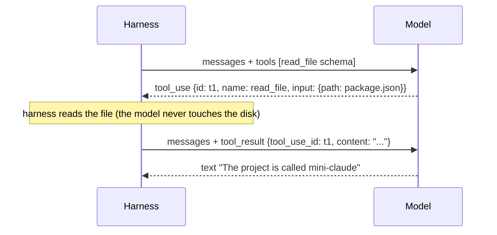

# Lesson 4: Tool calling

## Concept

The model cannot read your disk, run commands or browse the web. It can only
produce output. **Tool calling** is a convention: we describe tools to the model,
and instead of answering in text it may reply with a structured *request* to call
one. The harness executes the request and sends the result back.



## The three pieces

1. **The schema** (`src/tools/readFile.ts`). A name, a description and a JSON Schema
   for the input. The description is a *prompt*: it is the only thing the model knows
   about the tool. "Always read a file before editing it" in a description shapes
   behaviour just like a system prompt does.
2. **The `tool_use` block**. The model's reply contains
   `{ type: "tool_use", id, name, input }`. `stop_reason` becomes `"tool_use"`.
3. **The `tool_result` block**. We reply with a *user* message containing
   `{ type: "tool_result", tool_use_id, content }`. The id pairs result with call,
   which matters when the model asks for several tools at once.

## The registry (`src/tools/registry.ts`)

- `schemas()` turns our `Tool` objects into what the API expects.
- `run(call)` finds the tool, checks required params, runs it and **never throws**.
  Every failure becomes `is_error: true` with a readable message:

```
Unknown tool "fly". Available tools: read_file
Missing required parameter(s) for read_file: path
read_file failed: File not found: src/mian.ts
```

Why not throw? Because models fix their own mistakes when they can see the error.
"File not found: src/mian.ts" leads the model to try `src/main.ts`. A crash ends
the conversation.

## Line numbers

`read_file` prefixes each line with its number (`    12|code`), like Claude Code
does. This lets the model refer to exact locations ("the bug is on line 12"), and
later lets it edit precisely.

## What we observed with a real model

With `qwen2.5:3b` the model called `read_file` with `limit: 1`, read only the first
line, then said it wanted to read more. Our harness stopped there because it only
does **one** tool round. Real tasks need many rounds: read, search, read again, edit,
run the tests. That is the agent loop, Lesson 5.

## Exercise

1. Write a `current_time` tool with no parameters that returns `new Date().toString()`.
   Register it and ask "what time is it?".
2. Make the description of `read_file` misleading (for example, "reads a web page").
   How does the model's behaviour change?
