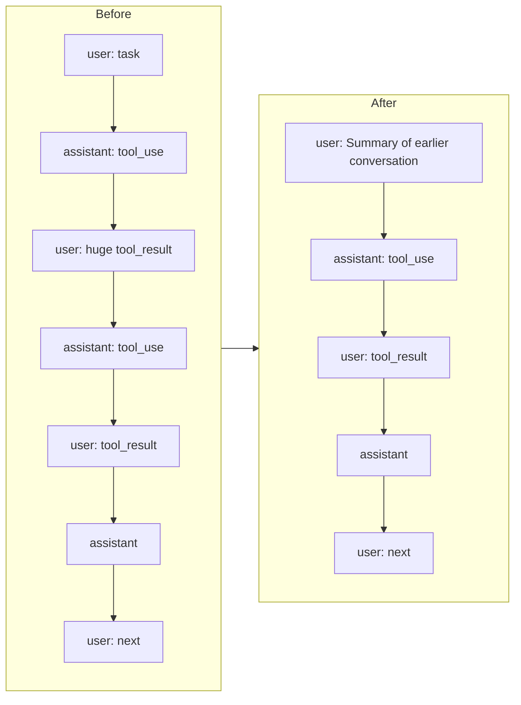

# Lesson 9: Context management and memory

## Concept

The **context window** is the maximum number of tokens the model can see at once:
system prompt, tool schemas, the entire history and its reply. Claude has about
200k tokens; a local Ollama model is often set to 4k to 32k. Because the harness
resends everything on every call (Lesson 2), a long session **will** hit the limit.

What happens near the limit:
- The API refuses the request (Anthropic) or **silently drops the oldest tokens**
  (Ollama beyond `num_ctx`, which is how your system prompt quietly disappears).
- Even before the limit, quality drops: important facts get buried in thousands of
  lines of old tool output. This is the "the model got dumber in a long chat" effect.

A harness fights this with four techniques, all in this lesson.

## 1. Measure (`src/context/tokens.ts`)

`estimateTokens()` uses about 4 characters per token. That is cheap and good enough for
budgeting. `Agent.contextTokens()` improves on it by **calibrating**: the API tells us
the real `input_tokens` of the last call, so we take that number plus an estimate
for only the messages added since. Type `/context` to see it:

```
context: ~1430 / 16384 tokens (8.7%), 2 messages
```

We also always send `num_ctx` to Ollama now (`OLLAMA_NUM_CTX`, default 16384), so the
window size is explicit instead of a silent default.

## 2. Truncate tool output at the source

One `cat` of a log file can be 500k characters. Every tool result is passed through
`truncateMiddle()` (about 15% of the window, max 30k characters). It keeps the head and
the tail (where errors and summaries usually are) and tells the model how to get
more:

```
... [41000 characters truncated to save context; use offset/limit or a narrower search to see them] ...
```

## 3. Compact (`src/context/compaction.ts`)

Before every model call: if the context is more than 75% full, **summarize the old
part of the conversation with the model itself** and replace it with the summary.



The tricky part is **where to cut**. If you cut between a `tool_use` and its
`tool_result`, the next API call fails. `findCompactionSplit()` always cuts *right
before an assistant message*. Then the new history is
`[user: summary, assistant, user, ...]`, which alternates correctly and keeps every
tool pair intact. The summarizer gets a flattened, clipped transcript and a prompt
asking for: goal, key facts, changes made, current state.

`/compact` triggers it manually. With only 2 messages it says "Nothing to compact
yet", because there must be something old to summarize *and* something recent to keep.

## 4. Memory: `AGENT.md` (`src/context/memory.ts`)

Compaction loses details. Some things must **never** be lost: "use pnpm, not npm",
"tests live in `tests/Feature`", "never rename `add`". Those go in markdown files that
are injected into the system prompt on every call, so they survive compaction and
even new sessions:

| File | Scope |
|------|-------|
| `~/.mini-claude/AGENT.md` | You, in every project |
| `./AGENT.md` | The project, committed so the team shares it |
| `./AGENT.local.md` | You, in this project, not committed |

Typing `# The add function must never be renamed` in the REPL appends it to `./AGENT.md`.
This is the same idea as `CLAUDE.md` in Claude Code or rules files in Cursor.

## What we observed with a real 3B model

The memory mechanics worked: the rule was saved, reloaded, and the model quoted
"The add function must never be renamed" back. But `qwen2.5:3b` **ignored** the other
rule ("Start every answer with MINI:") and did not read the file as asked. Small
models follow long system prompts poorly. A harness can make instructions *available*;
whether they are *followed* depends on the model. That is why the final demo uses a
bigger model.

## A real compaction run, and its cost

With `OLLAMA_NUM_CTX=4096`, asking the 3B model to read `composer.json`, then
`config/app.php`, then `config/database.php` in the Laravel project:

```
>   > Reading composer.json
>   > Reading config/app.php
  [context compacted: ~3073 -> ~2574 tokens, 3 messages summarized]
>   > Reading config/database.php
  [context compacted: ~3569 -> ~2590 tokens, 5 messages summarized]
> /context
context: ~3125 / 4096 tokens (76.3%), 6 messages
> Which three files did you read?
  [context compacted: ~3146 -> ~2159 tokens, 5 messages summarized]
You have read: 1. config/database.php  2. config/redis.php  3. ...
```

The mechanics worked: three compactions, and the conversation never broke. But
after a summary of a summary of a summary (written by a small model), the agent
**forgot** `composer.json` and `config/app.php`, and named a file it never read.
Compaction is lossy, and errors compound. Defenses real harnesses use: a bigger
window, a strong model for summaries, keeping the original request verbatim,
putting durable facts in memory files, and **sub-agents** that keep big outputs out
of the main context in the first place (Lesson 10).

## Exercise

1. Set `OLLAMA_NUM_CTX=4096`, then read a few big files. Watch `/context`, and see the
   compaction message appear.
2. Improve the token estimate: count code differently from prose, or use a real
   tokenizer library, and compare with the API's `input_tokens`.
3. Make compaction keep the **original user request** verbatim in the summary message.
   Why might that matter for long tasks?
