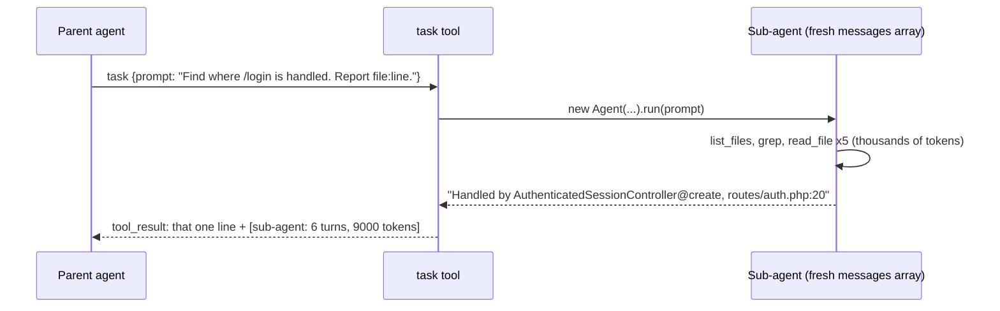

# Lesson 10: Sessions, sub-agents and evals

Three ideas that turn a demo into a tool you can rely on.

## 1. Sessions (`src/session.ts`)

Close the terminal and the `messages` array is gone. Since the whole "state" of an
agent *is* that array (Lesson 2), saving a session just means saving the array.

The file format is **JSONL** (one JSON object per line), stored at
`~/.mini-claude/sessions/<project-path-slug>/<id>.jsonl`:

```jsonl
{"type":"meta","id":"2026-10-18T09-40-00-000Z_1a2b3c4d","cwd":"/workspace","provider":"ollama","model":"qwen2.5:7b"}
{"type":"message","message":{"role":"user","content":[{"type":"text","text":"explain routes/web.php"}]}}
{"type":"message","message":{"role":"assistant","content":[{"type":"tool_use","id":"...","name":"read_file",...}]}}
{"type":"replace","messages":[...]}
```

Why JSONL and append-only?
- **Crash-safe.** Each line is written whole. If the process dies mid-write, only the last
  line is broken, and `Session.open()` skips it.
- **Cheap.** Adding a message appends one line instead of rewriting the file.
- **Readable.** `tail -f` the file while the agent works to watch the raw protocol.

Two events break "append-only": compaction (history shrinks) and `pushUser` merging
into the last message. `sync()` detects both (by comparing the last saved message) and
writes a `replace` record with the full history. Replaying the lines in order always
rebuilds the exact array.

The agent emits a `history` event whenever messages change, and the CLI persists it.
The loop knows nothing about files: the same separation as the renderer in Lesson 8.

```bash
npm start -- --resume          # latest session for this project
npm start -- --session <id>    # a specific one (/sessions lists them)
```

## 2. Sub-agents: the `task` tool (`src/agent/subagent.ts`)

Lesson 9 showed that compaction loses information. A better strategy is to **never let
the junk into the main context**. Exploring a codebase produces thousands of lines of
file contents and search results, but the parent only needs the conclusion.

A sub-agent is just **a tool whose implementation is another agent loop**:



Design decisions:
- **Fresh context.** The sub-agent sees only the prompt, not the parent's conversation.
  That is why the tool description insists on a "complete, specific prompt".
- **Only the report comes back.** `tests/subagent.test.ts` checks that a 500-line file
  read by the sub-agent never appears in the parent's history.
- **No recursion.** The sub-agent's registry has no `task` tool.
- **Same permissions.** The sub-agent shares the parent's `PermissionManager`, so its
  writes still ask you. The `task` tool itself is `kind: "read"` because it does
  nothing by itself.
- **Visible activity.** Its tool calls are rendered indented under the task (`    | > Reading ...`).

This is how Claude Code's Task/Agent tool and "explore" sub-agents work. It can also
run several sub-agents in parallel, which our sequential loop does not do.

## 3. Testing a non-deterministic system

There are two different questions:

| Question | Tool | Where |
|----------|------|-------|
| Does the **harness** behave correctly? | Unit/integration tests with a **scripted fake LLM**. Deterministic, free, fast. | `tests/` (64 tests) |
| How well do **harness + model** solve tasks? | **Evals**: real tasks, real model, automatic checks, repeated N times, reported as a pass rate. | `evals/` |

The fake LLM (`ScriptedProvider`) answers from a script and records every request,
so a test can assert on exactly what the harness sent: "after the tool ran, the next
request must contain a `tool_result` with this id". Tests cover the loop, parallel
calls, error recovery, permissions, interrupts, streaming parsers, compaction,
sessions and sub-agents.

Evals (`evals/tasks.ts`) set up a temp project, run the agent in `auto` mode, then
**check the outcome, not the words**:

- `fix-add-bug`: not "does it print 5" (Lesson 7 showed a model hard-coding
  `console.log(5)`), but "does `add(10, 7)` return 17".
- `find-controller`: does the answer contain `ReportController@show`.
- `create-module`: can `greet.js` be imported, and does `greet('Ada')` return `Hello, Ada!`.

```bash
npm run eval -- --runs 3
```

Because models are random, one run proves little. Run each task several times and
compare **pass rates** when you change the system prompt, a tool description, or the
model. This is how harness teams decide whether a change is an improvement.

### Real results (CPU only, 2 runs per task)

| Task | qwen2.5:3b | qwen2.5:7b |
|------|-----------|-----------|
| fix-add-bug | 0/2 | 1/2 |
| find-controller | 0/2 | 2/2 |
| create-module | 0/2 | 0/2 |
| overall | **0/6** | **3/6 (50%)** |

Same harness, same prompts: the model is the biggest lever. Reading the failures is
where you learn the most:
- 3B often answered in **one turn without calling any tool** ("I'll fix it" and stop),
  or invented paths (`src/Http/Controllers/ReportsController.php`) instead of
  running `list_files`.
- 7B failed `create-module` both times the same way: it wrote CommonJS
  (`exports.greet = ...`) without looking at `package.json`, which says
  `"type": "module"`. A system-prompt rule like "check the project's module system
  before creating files" is the kind of fix you would now measure with the evals.

## The final demo: mini-claude on this Laravel app (qwen2.5:7b)

Run on a copy of the repository (`/tmp/laravel-demo`), so the real project was not touched.

**1. Explain the routes, with a sub-agent.** Accurate on the first try. The sub-agent
read both route files; its summary listed all 14 routes in `routes/auth.php` correctly,
and the parent's context only grew by the report (3,885 input tokens in total).

**2. Fix a real bug: leftover git merge-conflict markers in `README.md`.** It worked,
but it took several sessions and a human in the loop, which is very instructive:

| What happened | Which harness feature handled it |
|---------------|----------------------------------|
| The model invented an `old_string` that is not in the file | `edit_file` refused; the model re-read the file |
| It printed the whole fixed file, then said "let's use write_file" and stopped | A user nudge |
| It generated a long `write_file` call, and the HTTP stream died after 300 s | Found a **harness bug**: Node's fetch has a 300 s body idle timeout. Fixed in `src/llm/http.ts` |
| Ollama returned an empty message twice | New warning; the empty reply is replaced so the history stays valid |
| We restarted with `--resume` on the fixed code | Sessions: 14 messages restored |
| It copied `66|=======` (with line numbers) into `old_string` | New targeted `edit_file` error explaining the prefix mistake |
| It tried to delete the **License** section by mistake | Permission prompt: `n: those are NOT conflict lines...` |
| It re-read lines 66-68 and removed the markers in two approved edits | Error recovery plus feedback |

Final diff (`git diff README.md`):

```diff
-<<<<<<< HEAD
+# admin-panel-laravel-9
 ...
 The Laravel framework is open-sourced software licensed under the MIT license.
-=======
-# admin-panel-laravel-9
->>>>>>> 807910ee5a1f72d41aa4b739b42014b7ba556466
```

The model's own "verification" grep had a broken pattern, so its "No matches" proved
little; `grep -cE '^(<<<<<<<|=======|>>>>>>>)' README.md` returning 0 did. Never trust an
agent's claim of verification more than a check you run yourself.

The big takeaways:
1. **The harness turns model weaknesses into recoverable situations**: tool errors,
   permission feedback, interrupts, resume. Without them, each failure above would
   have been a corrupted file or a crash.
2. **Watching real runs finds real harness bugs.** Three of the fixes in this project
   (the fetch timeout, empty replies, the line-number error) came from this one demo.
3. **Small local models are great for learning, not for real work.** With Claude
   (`ANTHROPIC_API_KEY`), the same harness does this task in one go.

## Exercise

1. Add an eval for a multi-file change, such as renaming a function used in three files.
2. Run the evals with and without the "How to work" section of the system prompt.
   Did the pass rate change?
3. Let the parent run several `task` calls in parallel with `Promise.all` (they are
   independent). What do you need to change in the renderer?
